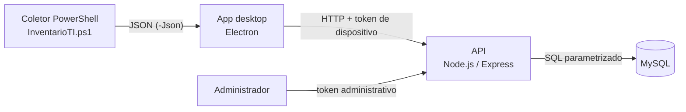

# Inventário TI para Windows

Sistema de inventário de computadores Windows. Um coletor em PowerShell reúne as informações da máquina; um aplicativo desktop (Electron) e uma API (Node.js + MySQL) permitem centralizar as coletas em um banco de dados.

O projeto foi criado para estudo e portfólio, com foco em PowerShell, tratamento de erros, compatibilidade e segurança de dados.

O coletor também é utilizado internamente, em ambiente autorizado de uma empresa de pequeno porte, como apoio ao controle de ativos e dispositivos Windows. Dados reais desse ambiente não fazem parte do repositório.

> **Estado do projeto:** a API e o aplicativo desktop estão em desenvolvimento e foram validados apenas em ambiente local. A implantação remota ainda não foi configurada nem testada. Veja [Estado de validação](#estado-de-validação).

## Modos de uso

- **Autônomo:** somente o coletor, que grava cada coleta em um CSV local. Não exige Node.js nem banco de dados.
- **Integrado:** o aplicativo desktop executa o coletor, e a coleta é enviada à API, que a grava no MySQL.

## Arquitetura



O token administrativo fica somente com o administrador e no servidor (como hash). O aplicativo desktop usa apenas o token do dispositivo, que só permite enviar coletas do equipamento ao qual está vinculado.

## Componentes

| Componente | Pasta | Função | Documentação |
| --- | --- | --- | --- |
| Coletor | raiz (`InventarioTI.ps1`) | Coleta os dados da máquina e exporta em CSV ou JSON | [InventarioTI.ps1](InventarioTI.ps1) |
| API | `api/` | Recebe e consulta coletas, cadastra dispositivos, autentica | [api/README_API.md](api/README_API.md) |
| Aplicativo desktop | `desktop/` | Executa o coletor e envia a coleta à API | [desktop/README_ELECTRON.md](desktop/README_ELECTRON.md) |
| Banco de dados | `sql/` | Migrações versionadas do MySQL | [sql/README_BD.md](sql/README_BD.md) |

## Estrutura do projeto

```text
InventarioTI.ps1        coletor (Windows PowerShell 5.1)
api/                    API Node.js/Express
  src/                  servidor, rotas, middlewares e regras de segurança
  test/                 testes automatizados
desktop/                aplicativo Electron (Electron Forge + Webpack)
  src/                  processo principal, preload, interface
sql/                    migrações do MySQL
docs/                   documentação dos componentes
AGENTS.md               instruções para assistentes de IA que trabalham no repositório
LICENSE
```

## Requisitos

| Componente | Requisitos |
| --- | --- |
| Coletor | Windows com PowerShell 5.1 (PowerShell 7 ainda não foi validado) |
| API | Node.js (testado com v24.21.0), npm e MySQL 8.4 (testado com 8.4.11) |
| Aplicativo desktop | Windows, Node.js e npm, mais API e MySQL ativos |

## Início rápido

### Modo autônomo (coletor + CSV)

```powershell
git clone https://github.com/KaduDuartee/Inventario-TI-Windows.git
cd Inventario-TI-Windows
.\InventarioTI.ps1
```

O CSV é salvo em `%LOCALAPPDATA%\InventarioTI\inventario.csv`.

### Modo integrado (coletor + desktop + API + MySQL)

1. Prepare o MySQL e aplique as migrações: [sql/README_BD.md](sql/README_BD.md).
2. Configure e inicie a API: [api/README_API.md](api/README_API.md).
3. Gere o token administrativo e cadastre o dispositivo (também em [api/README_API.md](api/README_API.md)).
4. Execute o aplicativo desktop: [desktop/README_ELECTRON.md](desktop/README_ELECTRON.md).

## Segurança e privacidade

- **Credenciais separadas.** O token administrativo e o token de dispositivo são distintos. O banco guarda apenas o hash do token de dispositivo, e o token administrativo é configurado no servidor como hash (`ADMIN_TOKEN_HASH`). Nenhum token administrativo é embutido no coletor ou no aplicativo desktop.
- **API.** Consultas SQL parametrizadas, validação explícita dos dados recebidos, gravação transacional e revalidação da credencial e do vínculo do dispositivo no momento de gravar.
- **Aplicativo desktop.** O renderer não tem acesso direto ao Node.js: a comunicação passa por preload e IPC com validação. O token do dispositivo é protegido com `safeStorage`, o que não substitui a revogação e a autorização no servidor.
- **Coletor.** Não coleta a chave completa do Windows (somente os últimos cinco caracteres) e não lê senhas, tokens ou credenciais do computador.
- **Rede.** A API de desenvolvimento aceita conexões apenas do próprio computador (loopback). Uma implantação remota exige HTTPS com certificado válido e MySQL em rede privada, acessível apenas pela API.
- **Dados sensíveis.** CSV e JSON podem conter nome do computador, número de série, endereço IP, identificação parcial da licença e ID do AnyDesk. Não publique esses dados em commits, issues, capturas de tela ou exemplos.

No modo integrado, os dados da coleta saem da máquina e são gravados em um banco de dados. Use esse modo somente em equipamentos para os quais você tenha autorização.

## Estado de validação

**Validado em ambiente local:**

- suíte de testes da API (43 testes aprovados na última validação);
- rotas de saúde da API e do banco;
- coleta em JSON pelo PowerShell;
- gravação dos campos de inventário, produtos Office e IDs do Office;
- revogação e rotação de credenciais, e falha de credencial;
- comportamento com API ou banco indisponíveis;
- coleta feita pelo instalador Windows x64 (versão 1.0.1).

**Ainda não validado:**

- hospedagem remota, HTTPS, DNS e certificados;
- proxy reverso em produção;
- restauração de backup do banco;
- testes de carga;
- atualização em outros perfis de usuário e versões do Windows;
- distribuição assinada do instalador.

A auditoria de dependências (`npm audit`) da API e das dependências de runtime do aplicativo desktop (`--omit=dev`) não apontou vulnerabilidades; há alertas conhecidos apenas em dependências de desenvolvimento/build do Electron (`oxfmt` e `@electron-forge/plugin-webpack`), que devem ser reavaliados antes de distribuição externa.

## Limitações conhecidas

- compatível somente com Windows;
- algumas instalações menos comuns do Office podem não ser identificadas;
- o AnyDesk só é identificado quando o arquivo de configuração existe e pode ser lido;
- não há inventário de macOS ou Linux;
- resultados podem variar conforme a versão do Windows e as permissões do usuário;
- a conexão remota entre aplicativo desktop e API ainda não está disponível.

## Próximas melhorias

- escolher a hospedagem e configurar a implantação remota (HTTPS, MySQL em rede privada, endereço do servidor no aplicativo desktop);
- assinar o instalador e definir o nome e a identidade definitivos do aplicativo;
- auditar as dependências do aplicativo desktop;
- organizar os blocos do coletor em funções;
- adicionar testes automatizados do coletor com Pester;
- executar análise estática com PSScriptAnalyzer;
- melhorar a compatibilidade com instalações menos comuns do Office;
- criar projetos separados para Linux e macOS.

## Uso responsável

Execute o coletor e o aplicativo somente em computadores próprios ou em equipamentos para os quais você possua autorização.

## Licença

Este projeto é distribuído sob a licença MIT. Consulte o arquivo [LICENSE](LICENSE) para conhecer os termos.
